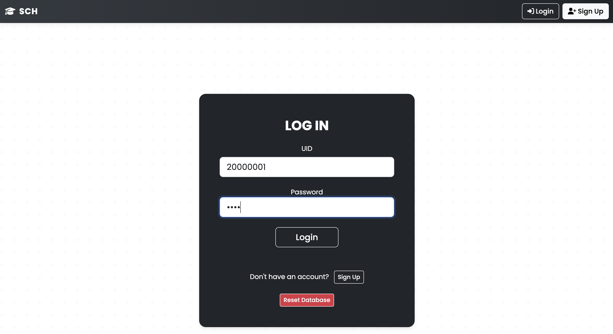
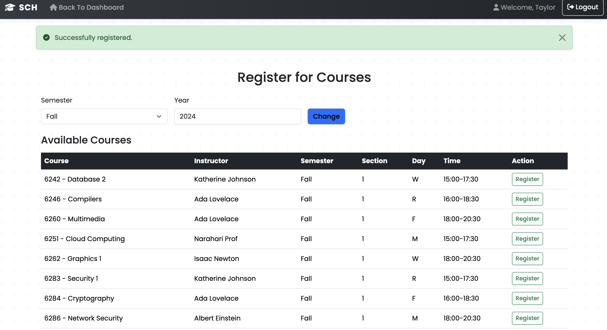
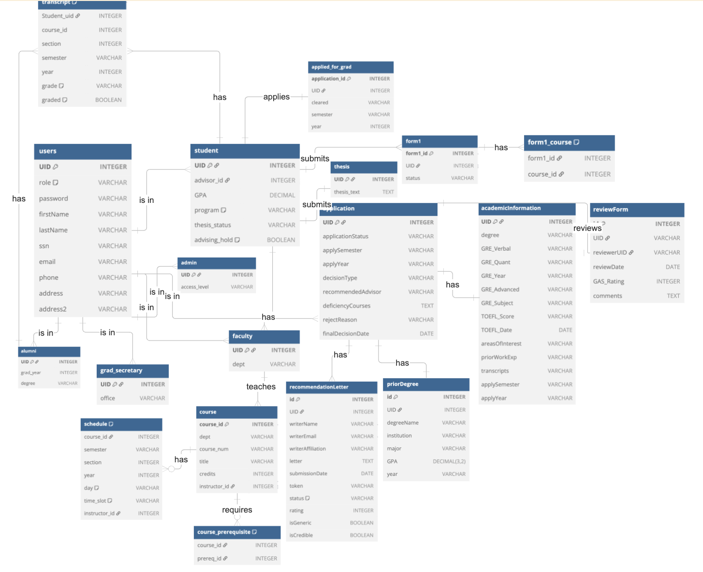

<div align="center">

# GradPath: Graduate Admissions, Registration & Advising System

**A full-stack web app that follows a graduate student through the whole university lifecycle: application, admission, course registration, advising, graduation, and alumni.**


</div>

---

## Overview

GradPath is an integrated graduate information system built for the Database Systems course at The George Washington University. It combines three subsystems into one application backed by a single normalized relational database:

| Module | What it handles |
| --- | --- |
| **APPS** (Admissions) | Online applications, recommendation letters, faculty reviews, and admission decisions |
| **REGS** (Registration) | Course catalog, schedules, registration and drops, grading, and transcripts |
| **ADS** (Advising) | Advisor assignment, Form 1 degree plans, thesis approval, graduation audits, and alumni records |

A user moves through the system seamlessly. An **applicant** who is admitted becomes a **student** in REGS, registers and completes courses, applies to graduate through ADS, and becomes an **alumni** record. Each role sees a dashboard tailored to its permissions.

<!-- Screenshots: add images to a /screenshots folder and uncomment.
<p align="center">
  
  
  
</p>
-->

## Features

### Role-based access control (7 roles)
Applicant, Student, Faculty, Faculty Admissions Committee (CAC), Graduate Secretary (GS), Admin, and Alumni each have their own dashboard and permissions. Protected routes check the session role before serving data, and users are redirected to the dashboard that matches their role.

### Admissions (APPS)
- Multi-step online application with academic history, GRE and TOEFL scores, and prior degrees
- Recommendation letters requested by applicants and submitted through unique token links
- Faculty review forms with ratings and recommendations (Reject, Borderline Admit, Admit without Aid, Admit with Aid)
- Final decisions by the CAC or Graduate Secretary. Admitted applicants are **matriculated** into student records automatically.

### Registration (REGS)
- Course catalog and semester schedule browsing
- Course registration with validation:
  - **Prerequisite checks** against the student's transcript
  - **Time-conflict detection**, which compares meeting days and parsed time slots against already-registered courses
  - **Duplicate-registration prevention**
- Dropping courses, and viewing transcripts with GPA
- Faculty views of teaching schedules, class rosters, and grade submission
- Graduate Secretary grade changes and transcript access
- Admin tools to add courses, schedules, and prerequisites and to assign instructors

### Advising & Graduation (ADS)
- Advisor assignment by the Graduate Secretary
- **Form 1** degree-plan submission, with advisor approval or denial
- PhD **thesis submission and approval**
- An **automated graduation audit** that checks program-specific requirements:

  | Requirement | Masters | PhD |
  | --- | --- | --- |
  | Minimum GPA | 3.0 | 3.5 |
  | Total credits | 30 | 36 |
  | CS credits | — | 30 |
  | Grades below B allowed | ≤ 2 | ≤ 1 |
  | Approved thesis | — | ✓ |

- Graduation clearance by the GS, which converts the student to **alumni** status
- **Academic suspension** that is detected automatically when a student has too many grades below a B

### Admin
- Create, edit, and delete users of any role
- A generic table viewer and editor for every entity in the database

## Database Design

The schema has **19 tables** and is normalized to **Third Normal Form (3NF)**. Every table has a primary key, values are atomic, and there are no partial or transitive dependencies.



**Core entities**
- **Users and roles:** `user` (shared identity and login) with a role-specific table for each role (`student`, `faculty`, `grad_secretary`, `admin`, `alumni`)
- **Admissions:** `application`, `academicInformation`, `priorDegree`, `recommendationLetter`, `reviewForm`
- **Academics:** `course`, `course_prerequisite`, `schedule`, `transcript`
- **Advising and graduation:** `form1`, `form1_course`, `thesis`, `applied_for_grad`

Constraints such as `CHECK` on roles, `UNIQUE` emails, and foreign keys enforce data integrity. Form input is passed through **parameterized SQL queries** to guard against SQL injection.

## Tech Stack

| Layer | Tools |
| --- | --- |
| Backend | Python, Flask (routing, sessions, flash messages) |
| Database | SQLite, raw SQL (joins, aggregates, subqueries) |
| Frontend | Jinja2 templates, HTML, CSS, Bootstrap, JavaScript |

## Getting Started

### Prerequisites
- Python 3.9+
- `sqlite3` command-line tool (preinstalled on macOS and most Linux distributions)

### Setup
 
```bash
# 1. Clone the repo
git clone https://github.com/hadya584/gradpath.git
cd gradpath
 
# 2. Create a virtual environment and install Flask
python3 -m venv .venv
source .venv/bin/activate        # Windows: .venv\Scripts\activate
pip install flask
 
# 3. Build and seed the database
sqlite3 myDatabase.db < phase-2.sql
 
# 4. Run the app
python main.py
```
 
Then open **http://localhost:5050** in your browser.

### Demo accounts

The seed data includes a test account for each role. All data is fictional.

| Role | UID | Password |
| --- | --- | --- |
| Student (Masters) | `20000001` | `pass` |
| Student (PhD) | `20000002` | `pass` |
| Applicant | `12312312` | `pass` |
| Faculty | `22002020` | `naraharipass` |
| Faculty Admissions Committee (CAC) | `60000001` | `pass` |
| Graduate Secretary | `10100011` | `gspass` |
| Admin | `10000001` | `adminpass123` |
| Alumni | `30000001` | `pass` |

To restore the original data at any time, rerun `sqlite3 myDatabase.db < phase-2.sql`.

## Project Structure

```
gradpath/
├── main.py            # Flask app: all routes and business logic for APPS, REGS, and ADS
├── phase-2.sql        # Schema (19 tables) + seed data
├── Phase-2-DB.png     # ER diagram
├── templates/         # Jinja2 pages for each role (admin/, dashboards, forms)
└── static/            # CSS, fonts, audio, and images
```

## My Contributions

This was a three-person integration project. Each of us first built one module separately, then we merged everything into a single schema and application.

**Hadya Osman: Registration (REGS)**
- Built the course registration flow, including the prerequisite, time-conflict, and duplicate checks
- Built the course catalog, schedules, transcripts, and drop functionality
- Built faculty grading, rosters, and schedules, plus Graduate Secretary grade management
- Integrated REGS into the shared schema and connected the role navigation between modules
- Helped unify styling across all three modules

**Teammates:** [Cole Garrison](https://github.com/Coleg2005) (Admissions, APPS) and [Sydney Berritt](https://github.com/sydneyberritt) (Advising and Graduation, ADS)

## Known Limitations & Future Work

This was built as a course project, not a production system. If I continued it, I would:

- **Hash passwords** with `werkzeug.security` instead of storing them in plain text, and stop showing them in admin views
- **Encrypt or tokenize SSNs** and other sensitive personal data
- **Split `main.py`** into Flask Blueprints for each module, with a shared data-access layer
- **Whitelist table names** in the admin table viewer and editor, which builds some queries dynamically
- **Load configuration** such as the secret key and debug mode from environment variables
- **Add automated tests** for the registration rules and the graduation audit

---

Built for CSCI Database Systems at The George Washington University, Spring 2025.
